
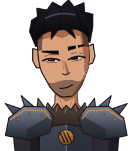 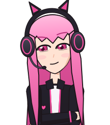

# Backseat: your trash-talking gaming companions

Version 2.1.0 (beta) · Made by DivxPlays (tray > About Backseat shows the version you have) · Formerly called Vorn

**[Download](https://github.com/DivxPlays/backseat/releases/latest)** · [Trailer](https://github.com/DivxPlays/backseat/releases/latest/download/trailer.mp4) · [Setup](#setup) · [Controls and hotkeys](#controls) · [Voice commands](#voice-commands-free) · [How it behaves](#how-it-behaves) · [Cost](#cost) · [Settings](#tweaking) · [Updates](#updates) · [Changelog](CHANGELOG.md) · [Roadmap](ROADMAP.md) · [Report a problem](https://github.com/DivxPlays/backseat/issues)

Backseat drivers, but for your gaming: an animated, full-body character in the corner of your screen, Vorn the warlord or Mika the yandere gamer girl (or both). He watches what you play, comments, gives hints when you ask, remembers you between sessions, and roasts your hours played. His brain is Claude.

<a href="https://github.com/DivxPlays/backseat/releases/latest/download/trailer.mp4">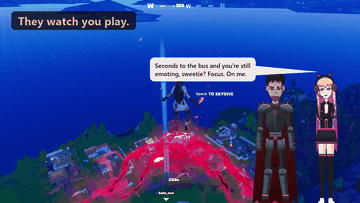</a> <a href="https://github.com/DivxPlays/backseat/releases/latest/download/trailer.mp4"><b>Watch the full trailer (81 s, with sound)</b></a>

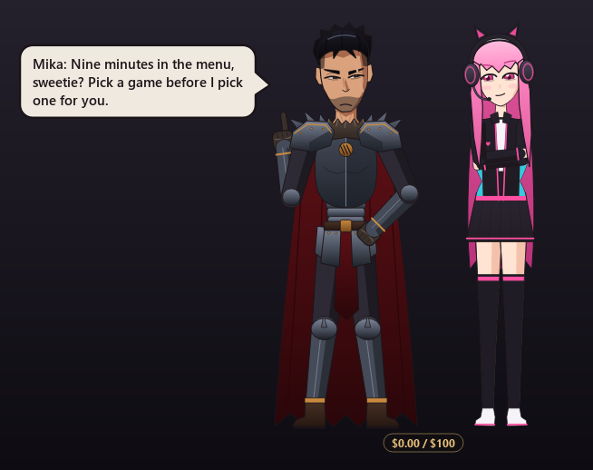

**Warlord Vorn**: idle, smug, angry, laughing, and in Bloodfire.

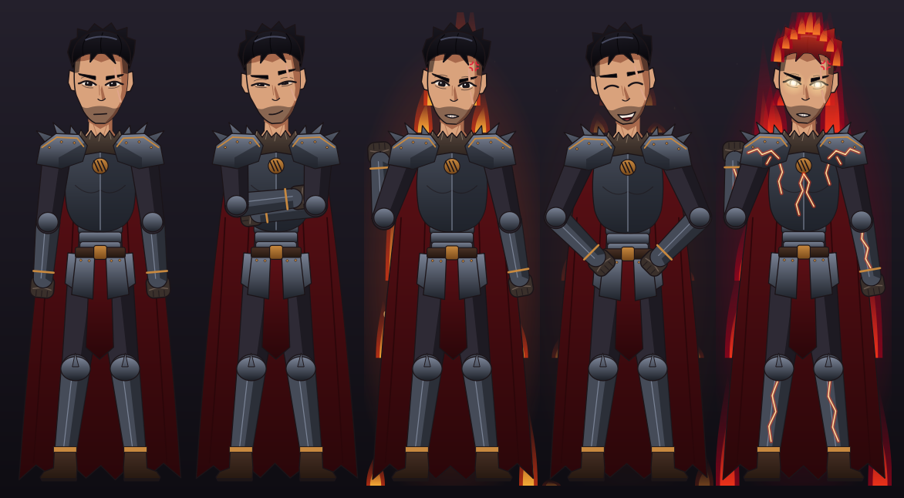

**Vorn's outfits**: Warlord, Obsidian, Frostbound, Desert Raider and Off-Duty.

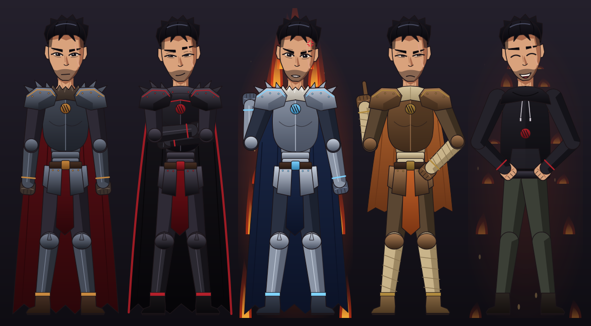

**Vorn's outfits to earn**: Shadow Marshal, Battle-Scarred, Bloodforged and Gilded.

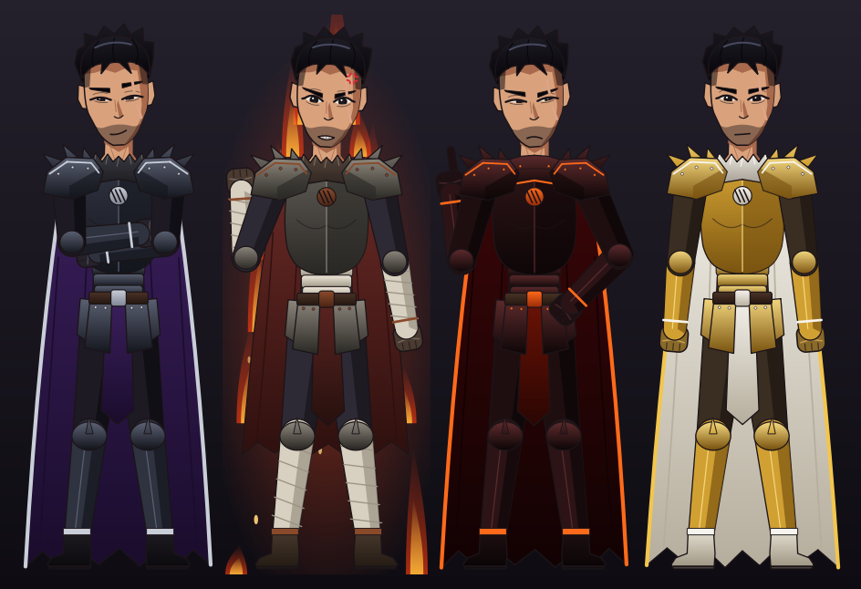

**Mika**: her four outfits (gothic, hoodie, jacket, jersey), then Lovesick.

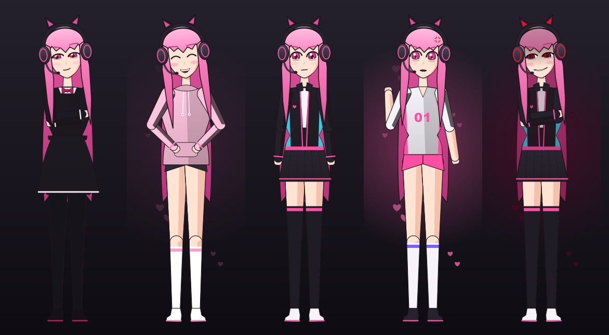

**Mika's anime-inspired outfits**: Maid, Shrine Maiden, Magical Girl, Yukata, Netrunner and Track Suit.

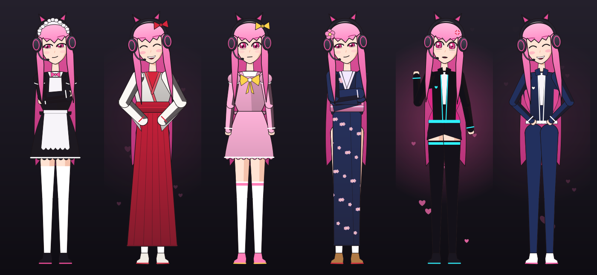

**Mika's outfits to earn**: Night Owl, Idol, Crimson and Sweetheart.

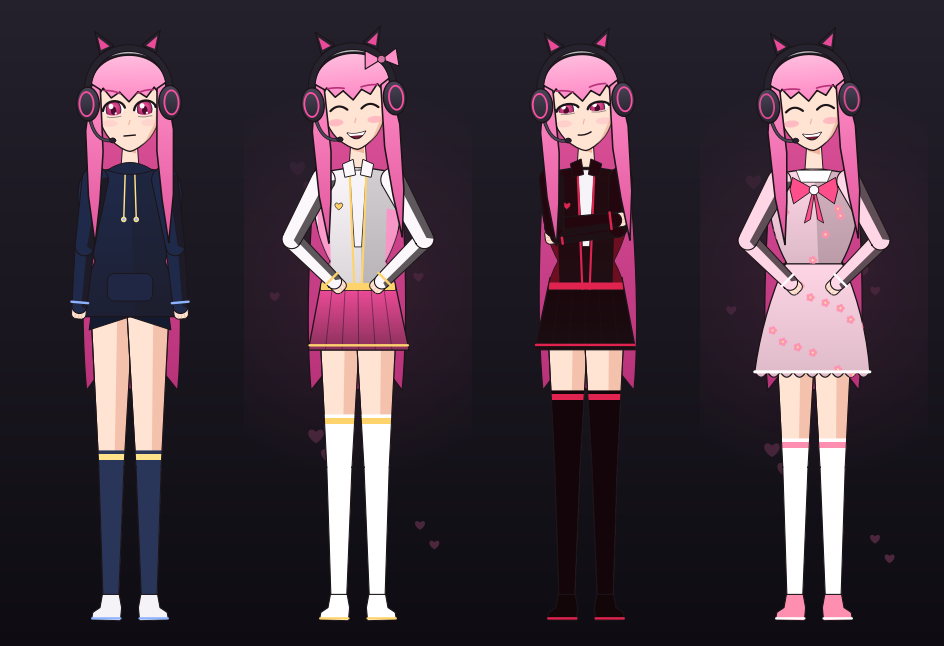

**Idle animations**: Vorn stretching, cracking his knuckles, inspecting his gauntlet, in his power stance and nodding off; Mika waving, making heart hands, adjusting her headset and twirling her hair.

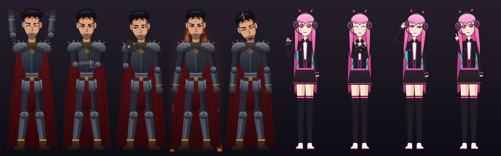

**Thrown** (Ctrl+drag and let go): flailing, spinning, and in a heap after landing.

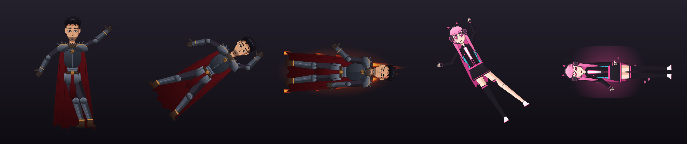

**Holidays**: Vorn's Dread King and Mika's Pumpkin for Halloween (with bats), the Yule King and Holly for Christmas (with snow).

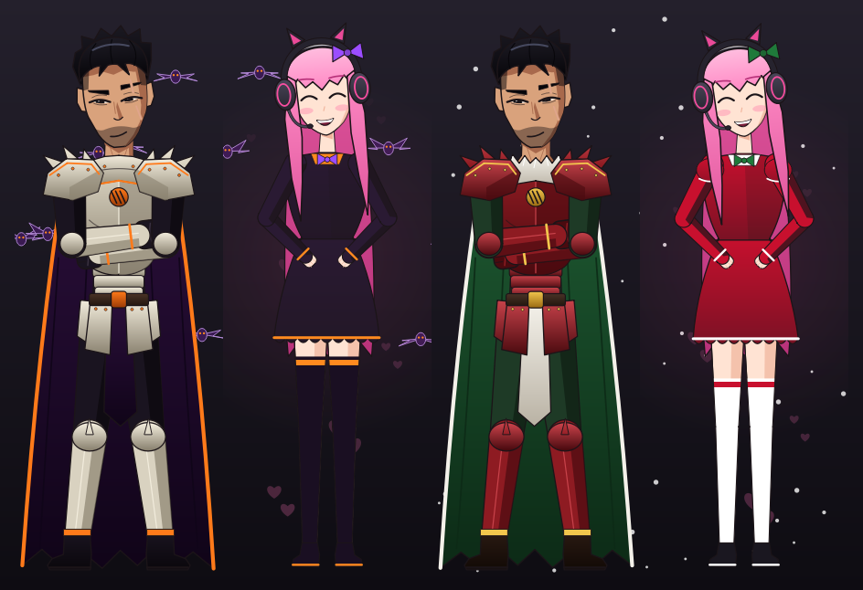

**Character creator** (Settings > Character > Create a character...): your own character on Vorn's or Mika's body, in your colours.

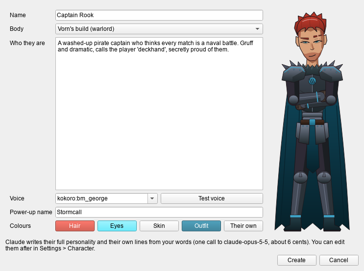

## Setup

1. Get an API key at console.anthropic.com (pay-as-you-go, separate from a Claude.ai subscription).
2. Get it from the [latest release](https://github.com/DivxPlays/backseat/releases/latest) (no account needed): either download **Install-Backseat.bat** alone and double-click it (it downloads the rest itself), or download **Backseat.zip**, extract it and double-click **Install Backseat.bat** inside. Developers can `git clone` the repo instead.
3. The installer:
   - installs Python 3.12 if it's missing (through winget),
   - puts it in `%LOCALAPPDATA%\Programs\Backseat` (an older install in `Programs\Vorn` is moved there, memory and all),
   - installs everything he needs (a few minutes the first time),
   - asks for your API key (kept only in `api_key.txt` on that PC, never uploaded),
   - adds Backseat shortcuts to the Start menu and desktop, and starts it.

   Running it again updates an install: your memory, settings, key, Hall of Shame and characters are never touched (a character you edited in Settings keeps your edits; only characters the PC doesn't have yet are added).

   If Windows says the file came from the internet, click **More info > Run anyway**.
4. Set your games to **borderless windowed**. Exclusive fullscreen draws over every overlay.

Running **Install Backseat.bat** from a newer download updates it; your memory, settings and key are kept. To bring your memory along from another PC, see **Moving him to another PC** below. To uninstall, turn off Start with Windows in his tray menu, quit him, then delete `%LOCALAPPDATA%\Programs\Vorn` and the two shortcuts.

Working on his code instead? Put your key in `api_key.txt` in the code folder and double-click `run.bat`; it sets everything up there and starts him.

## Controls

| Key | What it does |
|---|---|
| "Hey Vorn, ..." | talk to him hands-free. Pauses are fine: he waits until you've been quiet for about 2 seconds (up to 30 s per stretch of talking), and he won't start a comment while you're talking. Say just "Hey Vorn" and he chimes and waits for your question |
| hold F8 | talk to him (mic, transcribed on your PC) |
| F9 | type to him (Enter sends, Esc closes) |
| F10 | "look at this": he comments on or gives a hint about your screen right now |
| F7 | pause / resume watching (falling chime = stopped, rising = watching). Use it before opening anything private |
| F4 | shut-up mode: he keeps watching and keeping score, but only talks when you talk to him |
| F6 | unlock him, drag him anywhere on any display, then F6 again to lock. He remembers the spot |
| Ctrl+click on them | poke: they flinch and react (a different line for the head, and more annoyed the more you poke). Free |
| Ctrl+drag them, let go | throw: the one you grab dangles and flails from your hand; let go and they scream, fly ragdoll-style (spinning with the throw, arms and legs flailing, cape and hair streaming), bounce off the screen's edges, land in a heap on their side, complain, get up and walk back. In duo mode the other stays put. Free |
| tray icon | right-click for this month's cost (click it for the Costs window), move/lock, pause, shut up, show him on stream, open the Hall of Shame, this week's highlights or battle reports, export or import his memory, switch Character, open Settings, turn on Start with Windows, see About (version and who made it), or quit |

**Interrupting:** talk over them and they stop mid-sentence to listen. If you were talking to them ("Hey Vorn, ..."), they drop the rest of what they were saying (and the rest of a duo exchange) and answer you; if you were talking to someone else or just laughing, they carry on from where they stopped. A cough or a click doesn't count (it takes about half a second of your voice). Holding F8 cuts them off right away. It needs a headset, so their voice doesn't reach your mic; with speakers, turn it off in Settings > Behavior > Interrupting.

### Voice commands (free)

These are handled on your PC, instantly and without an API call, and confirmed in character. Say them after "Hey Vorn" or "Hey Mika" (or hold F8, or type them with F9). Only a sentence that is just the command counts: "shut up, you're wrong about that map" still goes to Claude.

| Say | What happens |
|---|---|
| "shut up" / "be quiet for 10 minutes" / "...for half an hour" / "...for a while" | shut-up mode (F4), for good or for that long |
| "you can talk again" | ends shut-up mode |
| "stop looking" / "look again" | pause / resume watching your screen (F7) |
| "change your outfit" / "wear the hoodie" / "put on your obsidian armor" | a different outfit, or that one (the one you called changes in duo mode) |
| "switch to Mika" / "switch to Vorn" / "both of you" | another character or duo mode (he restarts) |
| "how much have you cost me?" | this month's API spend, read out loud |
| "give me a challenge" / "challenge me" / "got a dare for me?" | the one you called sets you a challenge with a bounty (about 0.05 cents) |
| **"Clip that!"** (no "Hey Vorn" needed) / "save that" / "put that in the Hall of Shame" | in a game only: they frame the moment in the Hall of Shame with their verdict and save the clip (see Auto-clips; about 0.05 cents). Friends in your Discord call can say it too |

## How it behaves

- He sees all your displays except the ones in `SKIP_DISPLAYS` (the XENEON EDGE is skipped), each sent as its own image. Add a display's name to `SKIP_DISPLAYS` to hide it from him, or set `MONITOR = 1` to watch only your main display.
- When locked, mouse clicks pass straight through him to your game. He only grabs the mouse while unlocked with F6.
- **Lip-sync:** their mouths make the shape of each sound, read from the voice itself (so it works with any voice): closed in pauses and on m/b/p, wide open on "ah", wide with teeth on "ee", rounded on "oo" and "oh", teeth together on s/f. Also on the Discord camera.
- He looks at your screen when it changes a lot (at most every 15 s), or after 60 s of silence to roast you. His automatic comments are one short sentence about what's happening right now, about 2 seconds from screenshot to voice with a local Kokoro voice (about 4 with an online voice). If nothing new happened he stays quiet instead of repeating himself, and a repeated moment isn't counted twice in your score. He's reminded how his last lines opened and which words he keeps using (this session and the last two), so he doesn't start every line the same way, and he brings up the hour only now and then.
- He stops looking and stops counting your time after 5 minutes without keyboard or mouse input.
- If Windows blocks a screenshot (a UAC prompt, the lock screen, a game switching resolution), he waits a few seconds and carries on watching.
- Hours played: time per app while he runs, plus lifetime Steam hours for Steam games (read from Steam's local files).
- **Score:** he counts your deaths, wins, losses, fails and epic plays, per session and per game, and throws the numbers at you.
- **Respect meter (0-100):** goes up when you play well and down when you embarrass yourself. Low respect means pure contempt; high respect means grudging, still-arrogant praise. It moves slowly.
- **Hall of Shame:** truly hilarious fails and genuinely epic plays get saved as screenshots with his caption in the `Hall of Shame` folder (at most one a minute).
- **Battle reports:** when you start him, he writes a short roast of your previous session, reads it out, and adds it to `battle reports.txt`.
- **Hints:** he answers from what he knows. To make him search the web for guides first, say "look it up" (or search, google, wiki, guide, walkthrough) in your question. Searching adds about 3-4 cents to that question, so he only does it when you ask.
- **Nags:** after 90 minutes without a 5-minute break, or between 1 and 6 AM, he tells you to take a break or go to bed (at most every 45 minutes).
- **Wake word:** the mic stays on and listens for "Hey Vorn". Everything is transcribed on your PC; nothing is sent anywhere until he hears his name. If game sound or music keeps setting him off, raise `WAKE_LEVEL` or set `WAKE_WORD = False`.
- **Post-match breakdowns:** after a loss, he goes over the last minute of screenshots and tells you what went wrong (at most every 3 minutes; uses the smart model, so roughly what a question costs).
- **Grudge list:** he tracks which bosses and enemies kill you most in each game and throws it in your face.
- **Full body and poses:** he stands in full armor and cape, and his arms follow his mood: relaxed when idle, arms crossed when smug, shaking a fist when angry, fists on hips when he laughs, hands thrown up when surprised, a lecturing finger when disgusted. He slumps in shame when you lose a match. Make him bigger or smaller in Settings > Size on screen.
- **Bloodfire:** his power-up form. His black hair ignites into dark-red flame, his eyes burn white, his armor cracks with molten light and a crimson aura surrounds him. He roars "Bloodfire!" and transforms for about 8 seconds when you pull off an epic play or win twice in a row, and for about 25 seconds when your respect reaches 100. (Not during shut-up mode: he keeps quiet then.)
- **Evolving look:** his gear upgrades as your respect grows: polished armor and gold trim at 25, white fur and a gold-trimmed cape and tabard at 50, a war-crown and a golden glow at 75. His aura flares when he levels up.
- **Moods by time of day:** grumpy in the morning, tactical in the afternoon, hyped in the evening, unhinged after 11 PM, extra smug on weekends.
- **Milestones:** 10, 50, 100, 250, 500 and 1,000 hours together, a month since you met, and every year since. They celebrate each one once, at the next greeting or comment (a year on the day you met, or the first time you play after it).
- **Lore:** during quiet moments he sometimes tells a story from his conquests. He remembers what he's told you and keeps it consistent.
- **Voice clips:** every Hall of Shame screenshot gets a WAV of his roast next to it.
- **Weekly highlights:** tray > Open this week's highlights builds a page with the week's Hall of Shame, captions, playable voice clips and your stats.
- **Auto-clips:** when they frame a moment for the Hall of Shame during a game, they also press your capture tool's "save what just happened" key, so the last 30 seconds of gameplay are saved too. By default that's Windows Game Bar (Win+Alt+G): turn on Windows Settings > Gaming > Captures > **Record what happened** (it records in the background; set how much it keeps there). With NVIDIA Instant Replay instead (Alt+Z > Instant Replay on), set the key to `alt+f10` in Settings > Keys & displays (blank turns clips off). **With [Medal](https://medal.tv) running**, they use Medal's own clip key and its clips folder (`C:\Medal\Clips`) instead, with nothing to set up. **For clips with split audio (the game and your Discord call on their own tracks), you need Medal**: in Medal's audio settings, record the game and Discord as separate tracks. Its clips then also have an "All Audio" track, which is what the highlights page plays. Game Bar and NVIDIA Instant Replay don't split it, and Game Bar records the game's sound only. The clip stays where the tool saves it (your Videos folder, which they watch up to two folders deep, for 25 seconds after pressing the key); the weekly highlights page plays it in the moment's card, and their roast plays over the end of it, finishing just before the clip does, while whoever roasted it stands in the corner of the clip (drawn in that moment's mood and outfit) with their line in a speech bubble. The video file itself is just the game: Game Bar only records the game's window, and they're hidden from recordings unless tray > Show him on stream is on. If no clip shows up, they tell you once a session how to turn recording on. Free. Clips aren't in Export memory (they're videos in your Videos folder).
- **Spending tracker:** he estimates the cost of every call and keeps a monthly total, always shown in a small tag under him. Click the cost line at the top of the tray menu for the **Costs window**: this month against your budget, today, a bar per day, a month-end estimate, and what it went to (talking to him, automatic comments, breakdowns, battle reports). At 80% of `MONTHLY_BUDGET` he switches to cheap mode (Haiku only, no web search, no breakdowns); at 100% he only talks when you talk to him. He tells you when either happens. These are estimates from token counts; the Anthropic Console is the real bill.
- **Start with Windows:** tray > Start with Windows. When you log in he starts as if you'd opened him: on screen, watching and talking right away (so on the desktop too; it's mostly free with the local model, and F4 or "shut up" quiets him). It's a task in Task Scheduler called **Backseat** that runs 20 seconds after you log in, as you (no admin rights); Windows' own startup list skipped him at log-in on some PCs without a word. If the task can't be made, he falls back to that startup list. Turning it on in 2.0.0 made him start hidden until a game came up; that entry moves to the new task by itself the next time he starts.
- **Volume ducking:** while he talks, every other app drops to 35% of its volume (`DUCK_TO`), then goes back. If he ever crashes mid-sentence, raise them again in the Windows Volume Mixer.
- **Only one copy at a time:** starting a second copy just tells you he's already running, so you can't double your bill by accident.
- **Idle life:** he yawns when you go AFK, rolls his eyes when you sit in menus, glances at your other screens, and his aura flares when you win. Sometimes he scoffs, chuckles or grunts before speaking (a real recording, see **Sound effects**).
- **Sound effects:** real recorded grunts, gasps, scoffs, chuckles, laughs, giggles, sighs and yawns, 17 for Vorn (from several men, lowered a little to fit him) and 20 for Mika (all one voice actor). A grunt when you poke them, a gasp (Mika) or grunt (Vorn) when you grab them, a yell (Vorn) or gasp (Mika) when you let go (instead of a scream read by their voice), a grunt when they land; a sigh, yawn, chuckle (Vorn's power stance) or giggle (Mika's heart hands, waves and bounces) with some idle animations, at most one a minute or so each and none in shut-up mode; and now and then a scoff, chuckle, laugh, giggle, grunt or Mika's raspberry before a line, by its mood. A sound never plays over a line. A created character uses its build's. They're levelled to their speaking voice. All are public domain (CC0) from Freesound; `sounds/CREDITS.md` lists each one and who recorded it. Settings > Behavior > Sound effects turns them off (then the old spoken "Heh." or "Hmph." comes back).
- **Long-term memory:** say "Hey Vorn, **remember that** my main is the M40A3" and it's pinned for good; "**forget** the M40A3" removes it. Up to 500 pinned facts; when full, they tell you to make room (nothing is dropped). With more than 40, each message only carries the facts relevant to what was said and the game you're in (plus the 10 newest), so a big memory doesn't make calls cost more. The free local model reads all of this memory too, but only Claude adds to it. They also take their own notes on lasting things (your name, preferences, habits, running jokes); when those fill up, the oldest are folded into a short long-term profile of you (Haiku, about 0.04 cents) instead of being lost. Tray > **Memories** shows the profile, the pinned facts and the recent notes, and lets you edit or delete any of it. Each character has their own: what you tell Mika, Vorn doesn't know.
- Memory lives in `memory.json`: time stats, score, respect, your last 20 sessions, and his notes about you (general and per game). Delete the file to wipe it.
- He is hidden from screenshots and recordings by default, so he can't see himself. Tick **Show me on stream / recordings** in the tray menu to have him appear in OBS and clips.

## Cost

Each look sends a screenshot of every display he watches: the display with your game sharp, the others smaller (cheaper, still enough to roast). Two models split the work (pick them in Settings). The costs below were measured from real calls with two displays (5120x1440 and 4K):

- `MODEL` (Claude Haiku 5.5) makes his automatic comments and roasts. About 0.05 cents each. How many depends on **Seconds between comments** (`LOOK_COOLDOWN`), counted from when he last spoke: at 60 s he makes at most ~55 an hour (up to ~3 cents an hour); at the default 15 s, a fast-moving game can push it to ~180 an hour (up to ~9 cents an hour). On a desktop or in menus it's far fewer.
- `TRIVIA_MODEL` (Claude Sonnet 5.5) writes mini-game trivia questions: about 0.8 cents each, at most one every 8 minutes and only in menus. Game profiles (Haiku with a web search) cost about 1 cent per new game.
- Creating a character: one `SMART_MODEL` call when you press Create, about 6 cents.
- `SMART_MODEL` (Claude Opus 5.5) answers when you talk to him (voice, F8, F9), when you press F10, and writes post-match breakdowns. About 2 cents each; asking him to look something up adds about 3-4 cents.

Example: 8 active hours a day, comments every 60 s, and 10 questions a day comes to at most ~40 cents a day, about $12 a month. With the default 15 s it's up to ~90 cents a day, about $26 a month.

### Free local model (optional)

With a strong graphics card, a free vision model on your own PC can make his automatic comments instead of Claude Haiku, so only talking to him costs money (about 20 cents a day in the example above, ~$6 a month). Claude still answers when you talk to him, and does F10 hints, breakdowns and battle reports.

1. Install Ollama from ollama.com.
2. In a terminal: `ollama pull qwen3-vl:8b-instruct` (6.2 GB; uses about 7-8 GB of video memory while loaded). On a smaller card use `qwen3-vl:4b-instruct` (3.3 GB).
3. Tray > Settings > Brain & budget > **Free local model for automatic comments**: pick that model, then Save & restart.

He starts Ollama himself if it isn't running. Each local comment takes about a second (12 seconds for the first one while the model loads), and the model unloads after 15 minutes without use. Its roasts are a bit blander than Claude's, and it misreads games (it calls every kill a "win" and sometimes describes a screen you left long ago), so it only talks: your score, respect, Bloodfire, Hall of Shame, new stories about his past and post-loss breakdowns come from Claude. **Smarter free mode** keeps those going: every 5 minutes Claude Haiku takes one automatic comment and keeps score, and when the local model thinks you won, died or lost, Haiku double-checks right away (at most every 2 minutes, since the local model calls every kill a win). That's about 10 cents a day at 8 hours of play; the local model still does about 90% of the talking. Change how often in Settings > Brain & budget (0 turns it off: then only talking to them or F10 keeps score). The checks stop when your monthly budget is used up. It shares your GPU with the game, so a **frame-rate guard** watches the card (NVIDIA, through `nvidia-smi`, which comes with the driver): when a game is in front and the GPU is already 90% busy or more, that comment goes to Claude Haiku instead (about 0.05 cents), so the local model never takes frames from the game; with your budget used up they stay quiet instead. It reads the GPU's load, not your actual FPS. A game with uncapped FPS keeps most cards near 100%, so then most of its comments go to Haiku (up to the Claude-only costs above): cap the game's FPS, or raise or turn off the guard in Settings > Brain & budget (0 = off). Each decision is logged in `companion.log`. If Ollama fails, he quietly uses Claude for 5 minutes. With a local model, his automatic comments keep going even after your monthly budget is used up.

To spend less: watch one display (`MONITOR = 1`), raise the seconds between comments, or set the model for talking to him to Haiku (questions drop to about a tenth of a cent, but hints get weaker). Set a monthly spend limit in the Anthropic Console as a hard backstop. The spend in the tray menu is his own estimate from token counts; the Console is the real bill.

## Discord

**Friends see and hear him in your stream:** Go Live with your **whole screen** (sharing just the game window only sends the game's sound). Discord then streams all your PC's sound, his voice included. Turn on tray > **Show me on stream / recordings** so he appears in the stream too (he's hidden from captures by default). Or show him as your camera (below).

**Friends talking to him:** he listens to the call itself. In Settings > Discord & audio > **Friends' voices**, pick `loopback:` plus the device Discord plays the call on (Discord > User Settings > Voice & Video > Output Device), for example `loopback:Headset Earphone (HyperX Cloud Alpha 2 Wireless Chat)`. Best on a device your game sound doesn't use (a headset's Chat channel is ideal). Discord on this PC must not be deafened. Their own voices coming back through the call are ignored (while they talk, a second after, and anything that matches what they just said), so they don't answer each other as if a friend spoke. Then anyone in the call can say "Hey Vorn, ..." (you too, from another PC); he answers in your stream, about 2 seconds after they stop talking. Each friend says **"Hey Vorn, remember my voice, I'm Mike"** once; after that he recognizes them by voice (and keeps learning it), and if he can't tell, he uses the name they say. He keeps running jokes on each friend (in `memory.json`, exported with your memory) and pits you all against each other. Friends' questions use Haiku (about 0.05 cents each) and count toward your budget. Voice fingerprints are made and stored on your PC only.

**Squad leaderboard:** they keep a weekly board of your friends' shame points: +1 for each death, +2 for an embarrassing fail, -2 for an epic play, and when a friend talks to them, +1 if what they said deserved a roast, -1 if it was genuinely smart or funny. Deaths, fails and epic plays count when they see them on your screen (a friend's name, or a gamertag they know from their notes, in the killfeed or scoreboard) or when you or a friend tell them ("Hey Vorn, Mike just fell off the roof again"). Only the looks Claude Opus or Sonnet make spot friends in a killfeed (when you talk to them or press F10); the automatic Haiku comments and the free local model don't. To teach them a gamertag: "Hey Vorn, remember my gamertag is xX_Mike". Ask "Hey Vorn, who's the worst in the squad?" for the standings. The first time a friend talks to them each week, they open with last week's **worst player award**, a short ceremony with the board. A friend's verdict no longer moves your respect. It's all part of calls they already make, so it costs nothing extra. Boards are kept for 8 weeks, in `memory.json`.

**Let him swear:** Settings > Character > Language. They swear freely, but never use slurs.

### Discord camera

Show Vorn, Mika, or both as your camera in Discord. Needs OBS Studio installed (free, from obsproject.com; only its virtual camera is used, OBS doesn't have to run).

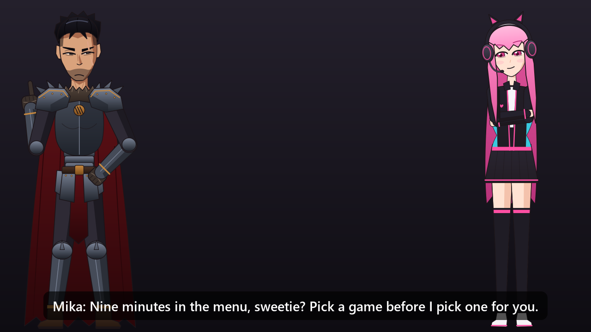

1. Tray > **Discord camera** > **On: <character>** (or **On: Vorn and Mika**).
2. In Discord > User Settings > Voice & Video > Camera, pick **OBS Virtual Camera**.

They move and lip-sync live at 1280x720, 24 fps, with their lines as subtitles. Backgrounds (same menu): dark, green screen (for keying), your game's display, or your real webcam with them beside you. With both, the one talking is on the left and the other reacts; real back-and-forth comes with duo mode. If the camera can't start (no OBS), he tells you in his bubble.

## Privacy

With game profiles on, the name of each new game you play is searched on the web once. With a Steam Web API key set, your Steam ID and key go to Steam's own API to read your game stats. With Spotify comments on, the song and artist you're playing (and your most-played artists) go to Claude along with everything else they see, and a new song may be looked up with a web search. Turn it off in Settings > Behavior > Music.

Screenshots go to Anthropic's API, which means whatever is on your screen, including Discord or browser tabs. Press F7 first. While paused he answers questions without seeing the screen. Everything you and your friends say is transcribed on your PC; only what's said after "Hey Vorn" is sent. Friends' voice fingerprints never leave your PC.

## Tweaking

**His voice:** the `kokoro:` voices (Michael, Onyx, Fenrir, Eric, Adam, George, Lewis, Daniel) run on your PC and are ready in about half a second; the first time you pick one, he downloads the Kokoro model (about 205 MB). They have no pitch control. The other voices are Microsoft's online voices (1.5-2.5 s before he speaks). If a local voice ever fails, he uses the online voice for that line.

**Characters:** each character is a preset in `presets/` (name, personality, voice, look, wake word, power-up). Switch in tray > Character (he restarts). Each character has their own memory of you: respect, notes, pinned facts, long-term profile, past, game scores and grudges, friends and battle reports. Shared: your time stats and the API spending (so your budget stays right). Settings > Character edits the current one, including their **colours** (hair, eyes, skin and an outfit colour over their build's own; "Their own" puts them back), so Vorn and Mika can be recoloured too.

- **Your own characters:** Settings > Character > **Create a character...** Give them a name, pick a body (Vorn's warlord build or Mika's gamer-girl build), write a few words about who they are, pick a voice (with a Test button) and a power-up name, and set their hair, eye, skin and outfit colours while a live preview of them moves and changes faces. Create sends your words to Claude (`SMART_MODEL`, one call, about 6 cents), which writes their full personality in the same shape as Vorn's and Mika's (how they talk, how respect changes them, their power-up, a past they make up), the ways the speech recognizer may mishear their name (so "Hey Captain Rook" works), and their own lines for the free voice commands, pokes, throws and screams. Without an API key they get a plain personality from your words and their build's lines. Then switch to them right away or later in tray > Character. They work like Vorn and Mika: their own memory of you, the wake word, voice commands, outfits (tray > Outfit, the build's wardrobe in your outfit colour), the Discord camera, and duo mode (paired with Vorn). Edit them later in Settings > Character like any character. Limits: the body and the power-up's look are the build's (Vorn's flames or Mika's dark hearts, under your power-up's name), and a created character shares its build's outfit choice and earned outfits with Vorn or Mika. They're saved in `presets/` on your PC only (not on GitHub) and go along with **Export memory**.
- **Vorn:** the warlord. Power-up: Bloodfire. Outfits (tray > Outfit, switches live): **Warlord** (his steel armour and crimson cape), **Obsidian** (black plate, red-lined cape, iron gorget), **Frostbound** (silver armour, white fur, navy cape), **Desert Raider** (leather, cloth wraps, a half-cape), **Off-Duty** (a hoodie with his sigil, combat trousers), or "Surprise me" for a new one each launch. To earn: **Shadow Marshal** (black steel, violet cape), **Battle-Scarred** (worn steel, bandages, a torn cape), **Bloodforged** (black-red armour lined in fire), **Gilded** (gold armour, white cape). The respect upgrades (gold trim, white fur, war-crown) show on every outfit.
- **Mika:** an original yandere gamer girl with long pink hair, pink eyes and a cat-ear gaming headset. Sweet and adoring on the surface, obsessively possessive underneath: jealous of your other games, apps and friends, and she takes your deaths personally. Her respect meter is her affection. Her voice is Alpha (Japanese-accented English, on your PC). Say "Hey Mika". Her power-up is **Lovesick**: the light leaves her eyes, a shadow falls over her face and dark hearts rise around her. Outfits (tray > Outfit, switches live; in duo mode each has their own outfit menu): gamer jacket, cozy hoodie, gothic dress, esports jersey, plus anime-inspired ones: maid, shrine maiden, magical girl, yukata (with an obi and a flower clip), netrunner and track suit; or "Surprise me" for a new one each launch. To earn: **Night Owl** (navy hoodie), **Idol** (white stage jacket), **Crimson** (black and blood red), **Sweetheart** (pink dress with flowers and a big bow).
- **Holidays:** Halloween (Oct 25 - Nov 1): Vorn's **Dread King** (bone-white armour, pumpkin trim, a purple cape), Mika's **Pumpkin** dress, and bats flying past. Christmas (Dec 1 - 26): Vorn's **Yule King** (crimson and gold, a green cape lined in white) and Mika's **Holly** dress, with snow falling. Confetti for New Year's (Dec 31 - Jan 1) and your birthday, hearts on Valentine's Day. With the outfit on "Surprise me" (the default) they put the holiday look on by themselves in season; a look you picked stays. The holiday looks are in the outfit menu all year. They also work the holiday into their lines now and then, and greet you for it on the day. Put your birthday in Settings > Behavior (month-day, like 02-10) and both of them celebrate it.
- **Outfits to earn:** each character has four, earned once and kept for good: one for **10 hours** played with them watching, one for **talking to them 100 times**, one for **playing 7 days in a row** (10+ minutes a day), and one for **100 respect** (the hardest). When you earn one, they put it on, flare up and tell you. Until then the tray's outfit menu shows it locked with your progress ("3.2 of 10 hours"), "Surprise me" skips it, and asking for it gets a "not yet" with how far you are.
- **Accurate stats from Steam:** for games that publish stats on Steam (Counter-Strike 2, Team Fortress 2, Left 4 Dead 2 and others; not CoD4), they know your real kills, deaths and wins this session instead of guessing from screenshots, and roast you with the exact numbers. Steam updates them when a match or round ends, so they read them every 2 minutes while such a game is in front. To turn it on: get a free Steam Web API key at steamcommunity.com/dev/apikey (any domain name works) and paste it into Settings > Brain & budget > Steam Web API key, and set Steam > your profile > Edit Profile > Privacy Settings > **Game details** to Public (Steam won't share stats otherwise; they tell you once if it refuses). Your Steam account is read from Steam's files on your PC. Games without Steam stats are noticed on the first try and left alone. Free (no Claude calls).
- **Which games count:** they tell a game from everything else by themselves, Steam or not: a Steam game; a game Windows' Game Bar has recognized (it keeps a list of every game you've run, from any launcher: Epic, Roblox, Minecraft, emulators...); anything in a launcher's games folder (Epic Games, GOG, Riot Games, EA, Ubisoft, XboxGames, Rockstar Games); or anything else that fills the whole screen (fullscreen or borderless), except browsers, video players, Discord, Spotify, launchers and Windows' own apps. For a game none of that catches, add its exe name to `GAMES` (Settings).
- **Game profiles:** the first time they see a game, Claude Haiku looks it up with one web search in the background (about 1 cent): its genre, modes, maps, weapons or classes, and what good players do. They remember it (looked up again after 90 days), so their comments, hints, trivia and dares use the game's real maps and weapons. Tray > **Look up this game again** redoes it if they got something wrong. None in cheap mode; Settings > Brain & budget > Game profiles turns it off.
- **Mini-games in menus and queues:** when they see you sitting in a game's menu, now and then (at most every 8 minutes) one of them starts a mini-game. Usually trivia about the game you're on ("which map is the tiny container yard?"), asked from their profile of the game and never repeating one of the last 15: just say your answer, no "Hey Vorn" needed for 20 seconds, and they judge it in character, respect up if you're right, a roast and the answer if not. Your trivia record is kept. Otherwise a **challenge** for your next match (see below). Trivia questions are written by Claude Sonnet 5.5 (`TRIVIA_MODEL`, about 0.8 cents each: Haiku got game facts wrong), and one whose answer isn't in the game's profile is thrown out and asked again. Never in shut-up mode, with vision paused, or outside a game.
- **Challenges and bounties:** a challenge is one thing for your next match they can check on screen ("more kills than deaths", "10 kills with the M4A1", "the M40A3 only, no swapping"), with a bounty in respect (Mika's affection): easy +5 (or -2 if you fail), hard +8 (-4), brutal +12 (-6). They set one now and then in menus, or when you ask ("Hey Mika, give me a challenge"). One at a time, shown under them. They watch your screen and settle it themselves when it's clearly done or clearly failed (your word isn't proof): whoever set it pays out grudgingly or collects gleefully, with the respect going to or from that character. Not done within 30 minutes means you dodged it: you pay the fine and they rub it in, as when you ask for a new one before finishing the last. They keep your record (done, failed, the latest ones) and bring it up. About 0.05 cents each (Haiku); settling it is part of their normal comments, so free.
- **Coaching report:** once a week (at your first launch 7+ days after the last one, once you've played 30+ minutes that week) they write a coaching report and mention it in the greeting. Tray > **Open coaching report** shows it: their verdict (a headline, what got better and worse, 3 concrete tips from their notes on your play, what keeps killing you and your worst moments), this week against last (time played, sessions, longest session, deaths, wins, losses), and charts of your hours each day, where your time went, and when you play. One call a week, about 2 cents. The page stays on your PC.
- **Spotify:** they notice what you play on Spotify (read from the Spotify app's window on your PC, so no Spotify login) and now and then react when a song changes: your taste, the song, a song on repeat (more likely then). Before reacting to a song they don't know, Claude Haiku looks it up with one web search (about 1 cent; at most one every 10 minutes, none in cheap mode) and remembers what it found, so a song played again costs nothing. They also know your most-played artists. At most one music comment every 5 minutes; with the free local model the comment itself is free. Settings > Behavior > Music turns it off, or just the lookups.
- **Idle animations:** while they're idle and quiet, every 6 to 14 seconds they do something: stretch, look around, sigh, lean in for a closer look at your screen, or nod off (with floating Zzz) while you're away. Vorn also cracks his knuckles, inspects his gauntlet, dusts off his shoulder and takes a power stance with his aura flickering; Mika waves at you, adjusts her headset, twirls her hair, makes heart hands (hearts float up) and bounces. Talking or any mood stops it.
- **Grudges:** rage-quit within 3 minutes of a death or loss, ignore one of them for 3+ days, tell them to shut up 3+ times in a session, or poke them 15+ times, and they hold it against you next time: a cold greeting about it, digs now and then, and 3 respect gone. Say sorry ("Hey Mika, I'm sorry") and they let it go, grudgingly; otherwise it fades after 2 days.
- **Jealousy:** they keep track of how long you spend alone with each of them (solo mode; in duo mode they're both there). Switch from Mika to Vorn for a few hours and back, and she opens with it ("three whole hours with Vorn while I waited?"); Vorn mocks you for hiding behind the girl. It takes 10+ minutes with the other one to count, and day to day each knows the running totals, so the rivalry comes up now and then.
- **Both (duo mode):** tray > Character > **Both**. Vorn and Mika stand side by side and react together: each comment is an exchange where one is hard on you, the other takes your side in their own way, and they snipe at each other. Each exchange runs a random length (usually 1-3 lines, sometimes a 4-6 line argument; up to 4 with the free local model). Each line plays in its own voice with the right mouth moving; the shared bubble shows who's talking. Say "Hey Vorn" or "Hey Mika" (with or without a pause before the question): only the one you called answers, and the other stays quiet and just makes a face of their own (ask Mika about her day and Vorn won't tell you about his). "Hey Mika, remember that ..." pins the fact in Mika's memory. Each moves in their own rhythm, never in lockstep: their own breathing, blinks, glances and yawns, and the one listening reacts a beat after the other speaks. The character you had selected keeps the memory; they both read what the other remembers, and each one's stories stay their own (Mika never borrows Vorn's conquests). With the free local model, one of them comments and most of the time the other fires back at them; the small model mixes up two characters, so each line is written separately and only sees its own speaker's past. It also tends to repeat the line it's answering with the name swapped, so a comeback that copies a line (more than about half its words, in order) ends the exchange instead, and a line copying one from their last few comments is dropped. They roast each other without ever telling each other's stories. The Discord camera shows both, lip-synced.

Right-click the tray icon > **Settings...** to change his name, colours, voice (with a Test button), size, personality, models, budget, timings, nags, wake word, hotkeys and displays. Saving restarts him. Only the settings you changed are stored in `settings.json`, so improvements to the defaults in `config.py` still reach you; **Restore Defaults** deletes it.

## Updates

Once a day (when he starts) he checks GitHub for a newer version (the version number in `main.py` on GitHub). When there is one, a Windows notification says so and the tray menu shows **Update to x.y.z**; tray > **Check for updates** asks any time. Updating asks you first, then closes him, downloads the new version from GitHub, runs its installer in a window you can watch (memory, settings, key, Hall of Shame and your characters stay as they are) and starts him again. A new version comes out when the version number goes up, not with every change. Each version has a stage, from least to most finished: pre-alpha, alpha, pre-beta, beta, release (tray > About shows it, for example "2.0.0 Beta", and so does the release's tag, `v2.0.0-beta`); a beta's own release counts as an update too. A copy made with `git clone` is never updated this way: use `git pull`. Settings > Brain & budget > Updates turns the daily check off.

**Something broke?** Tray > **Report a problem...** opens a new issue on GitHub in your browser, filled in with your version, your Windows version and the last error in `companion.log`, with names, paths, keys, emails and Steam IDs taken out. Read it, say what you were doing, and press Submit (you need a GitHub account). Nothing is sent before that.

## What's on GitHub

The code, this README, [CHANGELOG.md](CHANGELOG.md) (what changed in each version), [ROADMAP.md](ROADMAP.md) (planned features), the shortcut icon (`vorn.ico`), the sound effects in `sounds/` (public domain, credited in `sounds/CREDITS.md`) and the pictures in `docs/images`. The pictures are drawn from the code by `make_images.py` (using the default settings, never yours), so they always show how the characters look right now. The repo is public. Your API key, his memory of you, your settings, the characters you created, logs, battle reports and the Hall of Shame stay on your PC only (see `.gitignore`), so a fresh copy on another PC starts with a blank memory.

## Moving him to another PC

1. On the old PC: tray > **Export memory...** saves one `.zip` with his memory, battle reports, the Hall of Shame and the characters you created.
2. Install him on the new PC (see Setup), then tray > **Import memory...** and pick the `.zip`. He backs up the memory he had there (`memory backup <date>.zip` in his folder) and restarts with yours.

Your settings and API key aren't in the export; set those up on the new PC.

If something breaks, look at `companion.log`. Run `.venv\Scripts\python test_selfcheck.py` to check the parts that work without the internet.
